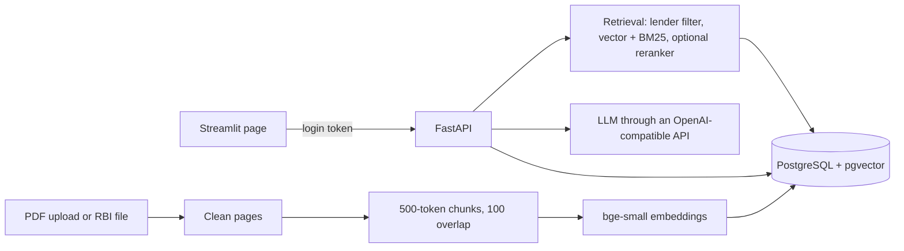

# EKIP RAG: ask questions about RBI Master Directions, with citations


A retrieval-augmented generation (RAG) system that answers questions about 21 Reserve Bank of India
Master Directions (commercial banks, NBFCs and small finance banks) and about PDFs you upload yourself.
Every answer cites the document and page, and the system says so when the documents do not contain the answer.

> Not legal or financial advice. Always check an answer against the official RBI document it cites.

## What it does

- Answers questions over **1,520 pages / 1,435 chunks** of real regulation text, citing `[n]` passages with document and page.
- **Refuses** with a fixed sentence when the passages do not contain the answer.
- Reads the **lender type** from the question ("NBFC", "small finance bank", "commercial bank") and searches only that type's documents.
- **Accounts and private collections**: users upload text PDFs into their own collections and ask across several files. The RBI collection is shared and read-only.
- Chat history, thumbs up/down feedback, voice input, and a saved **trace** of every answer (retrieved chunks, scores, timings).

## Architecture



Three containers run with Docker Compose: the database, the API and the page.

## How a question is answered

1. **Lender filter.** If the question names a lender type, only those documents are searched.
2. **Hybrid search.** Vector search (BAAI/bge-small-en-v1.5 embeddings stored in pgvector) and BM25 keyword search are merged with Reciprocal Rank Fusion. An optional cross-encoder reranker (BAAI/bge-reranker-base) re-reads the best candidates.
3. **Prompt.** The five best passages are numbered and sent with rules: use only the passages, cite `[n]`, otherwise reply with a fixed refusal sentence.
4. **Multi-part questions** in uploaded collections are split into sub-questions that are searched separately.
5. The answer, sources and trace are saved.

## Data

| | |
|---|---|
| Documents | 21 RBI Master Directions: 8 commercial banks, 9 NBFCs, 4 small finance banks (topics: credit facilities, KYC, responsible business conduct, cards, asset classification, outsourcing and more) |
| Size | 1,520 pages, 2.86 million characters, 1,435 chunks |
| Sources | `data/SOURCES.md` lists each document with its issue date, "updated as on" date and address |

## Evaluation

All numbers below were measured on this collection. Nothing here is estimated.

**Question sets**

- **44 answerable questions.** An LLM drafted 50 questions from randomly chosen passages (at most 3 per document). Each was reviewed against its passage: 6 were rejected and 16 were edited, leaving 44.
- **The same 44 in everyday wording**, written by an LLM, then checked for changed meaning (5 were corrected by hand).
- **15 unanswerable questions**: 13 plainly outside the documents and 2 near-misses (payment banks, co-operative banks).

**Retrieval** (lender filter on; Recall@5 = a correct passage is in the top 5; Hit@1 = it is first; MRR = average of 1 / rank of the first correct passage; a result counts if it is the source chunk or its neighbour in the same document)

| Method | Original: R@5 | Hit@1 | MRR | Everyday wording: R@5 | Hit@1 | MRR | Seconds per question |
|---|---|---|---|---|---|---|---|
| vector | 0.864 | 0.636 | 0.729 | 0.818 | 0.545 | 0.665 | 0.18 |
| BM25 | 0.886 | 0.795 | 0.827 | 0.750 | 0.386 | 0.543 | 0.14 |
| **hybrid (default)** | 0.932 | 0.705 | 0.802 | 0.795 | 0.614 | 0.704 | 0.14 |
| hybrid + reranker | 0.977 | 0.773 | 0.871 | 0.841 | 0.614 | 0.715 | about 9 |

**What the numbers show**

- **The lender filter helps every method.** Recall@5 rose from 0.795 to 0.864 for vector search and from 0.909 to 0.977 for the reranker (measured in the same run).
- **BM25 looks strongest on the original questions and weakest on everyday wording** (MRR 0.827 to 0.543). Those questions were written from the passages and share their words, which favours keyword search. Real users write differently.
- **The reranker leads hybrid by about 2 questions of 44** but is about 60 times slower on a laptop CPU, so hybrid is the default and the reranker is an option. A smaller reranker (MiniLM) took 5.8 to 8.4 seconds per question with Recall@5 of 0.932 to 0.955.
- **Chunk size 300 vs 500** (separate test database, hybrid, page rule): Recall@5 was 0.909 vs 0.932 on the original questions and 0.773 vs 0.795 on everyday wording. 500 stays. Smaller chunks did raise BM25's first-place rate on everyday wording (0.409 to 0.614).
- **Reranker candidates 10 vs 30:** the same Recall@5 (0.977) at 13.0 vs 23.7 seconds per question.

**Answers** (full pipeline with the LLM)

- 15 of 15 unanswerable questions were correctly refused, and 2 of 42 answerable questions were wrongly refused. This run used reranked retrieval.
- > Answerable questions wrongly refused: 3 of 44
    Answers that include a citation: 41 of 41
    Answers that cite a passage from the correct place: 39 of 41

**Known failures.** Several misses are rule sentences inside long chunks, or the same definition repeated in many documents (for example the definition of "commercial banks" appears in at least 10 chunks), so the document named in the question cannot be told apart from copies.

## Design decisions

- **Hybrid by default.** It reaches within about two questions of the reranker at a fraction of the time.
- **500-token chunks with 100 overlap.** The embedding model reads at most 512 tokens, so 500 fits and 800 would be cut off.
- **A fixed refusal sentence**, so refusals can be counted automatically.
- **One LLM client for any OpenAI-compatible provider.** Groq, Gemini, OpenRouter or a local Ollama server work by changing three settings.
- **Retries with backoff** on busy or rate-limited LLM calls. If the LLM is down, the passages are still shown.
- **Evaluation first.** `check_quality.py` fails if Recall@5 falls below the measured level, so changes to search can be checked in seconds with no LLM tokens.

## Limitations

- **Evaluation is small.** 44 questions means one question is 2.3 percentage points, so differences of one or two questions are noise. Results describe the RBI collection only; other documents may behave differently.
- **The LLM-written questions are easier than real ones.** The everyday-wording set shows the effect.
- **No multi-document questions in the evaluation.** That feature was tested by hand. A two-part question takes about 40 seconds and depends on the LLM splitting it correctly.
- **Text PDFs only.** Scanned documents need OCR, which is not implemented. Tables are read as plain text.
- **Question wording matters.** Synonyms and word endings can lower the rank of the right passage.
- **Documents are not kept current.** Each file records its "updated as on" date, but nothing re-downloads updates.
- **Privacy.** The question and the retrieved passages are sent to the LLM provider, so do not upload confidential documents.
- **Security.** Passwords are hashed with Argon2 and logins last 12 hours, but there is no password reset or login-attempt limit, and the app needs HTTPS before any public deployment. Refreshing the browser page logs you out.
- **Free-tier limits.** The default free LLM tier allows roughly 200,000 tokens per day, which is about 50 full answers.

## Run it

Prerequisites: Docker Desktop and a free API key from an OpenAI-compatible provider (this project used Groq).

```
git clone https://github.com/SUBASHRI-S/ekip-rag.git
cd ekip-rag
copy .env.example .env
```

Edit `.env`: choose a database password, set `LLM_BASE_URL`, `LLM_API_KEY` and `LLM_MODEL`, and generate the login secret with
`python -c "import secrets; print(secrets.token_hex(32))"` as `JWT_SECRET`.

```
docker compose up -d --build
```

Open http://localhost:8501, create an account, and upload PDFs. The first build takes several minutes, and the first question downloads the search model.

**Load the RBI collection (optional).** The RBI website blocks scripted downloads, so download the PDFs in a browser using the addresses in `data/SOURCES.md`, save them in `data/raw` with the file names listed there, then:

```
docker compose exec api python extract_all.py
docker compose exec api python -m app.ingest
```

**Tests and evaluation** (run from a local Python 3.12 environment with `pip install -r requirements.txt`)

```
python -m pytest -v        # 30 tests; the isolation tests need the local database and skip themselves otherwise
python check_quality.py    # retrieval quality gate
python evaluate.py         # retrieval comparison (needs the question files in data/processed)
```

Question files and extracted text stay in `data/processed`, which is not committed.

## Project layout

```
app/          chunking, cleaning, retrieval, ingestion, RAG prompt, LLM client, login helpers
ui/app.py     Streamlit page
main.py       FastAPI app
migrations/   Alembic database migrations
test/         unit and isolation tests
scripts/      dataset download script (blocked by the RBI site from scripts; kept for reference)
```

## Built with

Python 3.12, FastAPI, Streamlit, PostgreSQL with pgvector, SQLAlchemy and Alembic, sentence-transformers (bge-small, bge-reranker-base), rank-bm25, PyMuPDF, Argon2 and JWT, Docker Compose, GitHub Actions, pytest.

Author: Subashri S